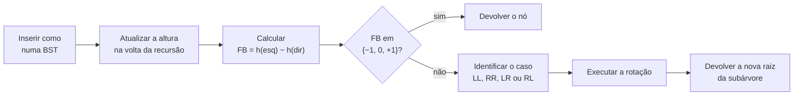

<!--META
{
  "title": "Árvores Balanceadas: Evoluindo uma BST para uma Árvore AVL",
  "header": "Árvores AVL",
  "tema": "Árvores binárias de busca degeneradas e o custo O(h) da busca; altura armazenada em cada nó, fator de balanceamento, rotações simples e duplas, os quatro casos de desbalanceamento (LL, RR, LR, RL), inserção recursiva autobalanceada em Python, testes obrigatórios e comparação entre BST e AVL com 100 valores crescentes.",
  "typing": ["FB = altura(esq) − altura(dir)", "AVL: FB ∈ {−1, 0, +1}", "LL, RR, LR, RL", "BST: h = 100 · AVL: h = 7"],
  "tecnologias": "Python 3",
  "tipo": "Aula expositiva com tutorial de implementação (estudo dirigido)",
  "professor": "Prof. Álvaro Gonçalves",
  "badges": [["Linguagem", "Python", "FF781F", "python"], ["Estrutura", "Árvore AVL", "FF4500"], ["Técnica", "Rotações", "E60000"]],
  "icons": "py",
  "icons_alt": "Python",
  "limitacoes": "A pasta chegou com o nome aula18-15-01-26; como os PDFs foram criados em 13/10/2026 e a aula anterior é de 01/10/2026, ela foi renomeada para aula18-15-10-26. Os slides (18 páginas) são quase só imagens e foram lidos visualmente; eles têm aviso de direitos autorais, por isso o conteúdo é explicado com redação própria. Os dois tutoriais são idênticos (mesmo hash MD5) e foram lidos integralmente. O tutorial parte de uma implementação de BST feita numa atividade anterior, que não está no repositório. O código do tutorial foi reunido num único programa e executado em Python 3; todas as afirmações numéricas do tutorial conferiram.",
  "files": {
    "DSA_E12_Arvores_Balanceadas.pdf": "Slides “A Máquina AVL” (18 páginas): BST degenerada × balanceada, fator de balanceamento, ponto de ruptura, rotações que preservam a ordem, os quatro casos (LL, RR, LR, RL), anatomia do nó AVL, fluxo de inserção, missão e testes de calibração, teste de estresse e estruturas de busca × semânticas.",
    "Tutorial_Balanceamento_AVL.pdf": "Tutorial de implementação “Evoluindo uma BST para uma Árvore AVL” (8 páginas): revisão obrigatória da BST e 13 etapas, da altura nos nós à comparação entre BST e AVL, com código Python, testes obrigatórios e questões de reflexão.",
    "Tutorial_Implementacao_Balanceamento_AVL_DSA_Atualizado.pdf": "Cópia idêntica (mesmo hash MD5) de Tutorial_Balanceamento_AVL.pdf."
  }
}
META-->

<br />

<h2 id="visao-geral">Visão geral</h2>

A [aula 17](../aula17-01-10-26/README.md) apresentou a árvore binária. Uma **árvore binária de busca (BST)** guarda os menores à esquerda e os maiores à direita, e a busca custa **O(h)**, em que *h* é a altura da árvore. O problema é que a ordenação **não garante uma árvore baixa**: inserindo 10, 20, 30, 40 e 50 nessa ordem, a BST vira uma "fila" inclinada, e a busca volta a ser O(n).

A **árvore AVL** resolve isso. Ela é uma BST que, a cada inserção, mede o desequilíbrio de cada nó e o corrige com **rotações**, mantendo a altura em O(log n). A aula combina os slides "A Máquina AVL" com um tutorial que evolui, passo a passo, a BST já implementada pela turma.



*Figura 1 — O fluxo de inserção AVL, conforme o slide "O Fluxo de Inserção AVL" e as etapas do tutorial.*

<br />

<h2 id="objetivos">Objetivos de aprendizagem</h2>

- Explicar por que uma BST pode degenerar e quanto isso custa na busca.
- Armazenar a altura em cada nó e calcular o fator de balanceamento.
- Implementar as rotações à direita e à esquerda e entender por que preservam a ordem.
- Identificar os quatro casos de desbalanceamento e a correção de cada um.
- Adaptar a inserção da BST para uma versão recursiva autobalanceada.
- Validar a árvore com testes e comparar a altura de uma BST e de uma AVL.

<br />

<h2 id="pre-requisitos">Pré-requisitos</h2>

- Árvore binária, nós e percursos, da [aula 17](../aula17-01-10-26/README.md).
- Recursão e caso-base, das [aulas 13](../aula13-08-09-26/README.md) e [14](../aula14-14-09-26/README.md).
- Busca binária e O(log n), da [aula 12](../aula12-03-09-26/README.md).
- Uma implementação de BST com inserção, busca e percurso em ordem (atividade anterior citada no tutorial).

<br />

<h2 id="fundamentacao-teorica">Fundamentação teórica</h2>

### 1. BST degenerada × balanceada

Os slides comparam duas BSTs com os mesmos valores. A degenerada (10 → 20 → 30 → 40 → 50) tem altura 4 e busca O(n). A balanceada (raiz 30) tem altura 2 e busca O(log n). A mensagem é direta: **a propriedade de ordenação não garante uma árvore baixa**.

> [!NOTE]
> Nesse slide, a altura é contada em **arestas** (5 nós em fila têm altura 4). O restante dos slides e o tutorial contam em **nós**: subárvore vazia tem altura 0, folha tem altura 1. Esta página usa a convenção do tutorial.

### 2. Altura e fator de balanceamento

Cada nó passa a guardar sua altura (`self.altura = 1` ao ser criado). A altura de um nó é $1 + \max(h_{esq}, h_{dir})$, e o **fator de balanceamento** é:

$$FB(n) = \text{altura}(\text{esquerda}) - \text{altura}(\text{direita})$$

| FB | Interpretação |
| :---: | :--- |
| −1 | direita um nível mais alta |
| 0 | alturas iguais |
| +1 | esquerda um nível mais alta |
| +2 | desbalanceamento à esquerda |
| −2 | desbalanceamento à direita |

Numa AVL válida, **todo** nó tem FB igual a −1, 0 ou +1. O tutorial destaca que `altura(no)` só **consulta** o valor armazenado: não percorre a árvore. Por isso as alturas precisam ser atualizadas na volta da recursão, dos nós mais profundos para cima.

### 3. Rotações: reorganizar referências, não dados

Uma rotação muda **quem aponta para quem** sem trocar os valores dos nós. Como o slide resume, rotações **não são algoritmos de ordenação**: elas recuperam o equilíbrio preservando a ordem da BST.

- **Rotação à direita** em `y`: o filho esquerdo `x` sobe, `y` vira filho direito de `x`, e a subárvore `T2` (antigo filho direito de `x`) passa a ser filho esquerdo de `y`.
- **Rotação à esquerda** é simétrica.

Em ambas, atualiza-se primeiro a altura do nó que **desceu** e depois a do que **subiu**, e o método devolve a **nova raiz** da subárvore.

### 4. Os quatro casos

| Caso | Sequência de teste | Forma | Correção |
| :---: | :--- | :--- | :--- |
| LL | 30, 20, 10 | linha reta à esquerda | rotação simples à direita |
| RR | 10, 20, 30 | linha reta à direita | rotação simples à esquerda |
| LR | 30, 10, 20 | zigue-zague | rotação à esquerda no filho, depois à direita na raiz |
| RL | 10, 30, 20 | zague-zigue | rotação à direita no filho, depois à esquerda na raiz |

No código, o caso é decidido pelo FB do nó e pela posição do valor inserido em relação ao filho: por exemplo, LL é `fb > 1 and dado < no.esquerda.dado`.

> [!WARNING]
> **Inconsistência nos slides.** Os slides "Caso LR" e "Caso RL" trazem no subtítulo as sequências 30, 20, 10 e 10, 20, 30, que são as dos casos LL e RR. As sequências corretas, usadas no próprio slide "Os Testes de Calibração" e no tutorial, são **30, 10, 20** (LR) e **10, 30, 20** (RL). As rotações descritas nesses slides estão corretas.

### 5. Inserção recursiva autobalanceada

O tutorial pede que a inserção seja **recursiva**, porque é na volta da recursão que cada ancestral atualiza a altura, calcula o FB e, se preciso, é substituído pela nova raiz devolvida pela rotação. Por isso `inserir` faz `self.raiz = self.inserir_recursivo(self.raiz, dado)`: uma rotação pode mudar a raiz da árvore inteira. Busca, mínimo, máximo e percursos continuam valendo sem mudanças, porque as rotações preservam a propriedade da BST. Já a **remoção** precisa de adaptação própria e fica para uma atividade posterior.

### 6. Por que balancear, e quando não

O slide final distingue **estruturas de busca**, em que o balanceamento é uma estratégia para otimizar o acesso e a hierarquia não tem significado real, de **estruturas semânticas**, como diretórios e organogramas, em que a hierarquia representa relações reais e não deve ser alterada só para reduzir a altura. O tutorial termina lembrando que árvores gerais têm vários filhos por nó, e que estruturas como as árvores B controlam a altura por outros mecanismos.

<br />

<h2 id="exemplos-praticos">Exemplos práticos</h2>

### Exemplo básico — a AVL do tutorial, com os testes obrigatórios

As etapas 1 a 11 do tutorial reunidas numa classe, seguidas dos testes da etapa 11:

```python
{{include:arv/avl.py}}
```

Saída esperada:

```text
{{include:arv/avl.out}}
```

Os quatro casos terminam com raiz 20 e percurso `[10, 20, 30]`. A sequência 10, 20, 30, 40, 50, 25 produz exatamente a estrutura esperada no tutorial: raiz 30, altura 3 e percurso em ordem `10 20 25 30 40 50`. É o "teste de estresse" dos slides.

### Exemplo aplicado — BST × AVL com 100 valores crescentes (etapa 13)

```python
{{include:arv/bst_x_avl.py}}
```

Saída esperada:

```text
{{include:arv/bst_x_avl.out}}
```

Inserindo 1, 2, …, 100 em ordem, a BST comum vira uma lista: altura 100 e 100 nós visitados para achar o 100. A AVL fica com altura 7 e visita só 7 nós, como o tutorial afirma. A inserção da BST foi escrita de forma iterativa para não depender de 100 chamadas recursivas aninhadas.

<br />

<h2 id="exercicios-resolvidos">Exercícios e resoluções comentadas</h2>

### Questões de reflexão do tutorial (etapa 13)

**"A ordenação mudou? Os dados mudaram? Ou apenas a organização das referências? Por que o custo da busca é O(h) e a AVL garante h = O(log n)?"**

<details>
<summary><strong>Solução proposta para estudo</strong></summary>

Nem a ordenação nem os dados mudam: o percurso em ordem continua crescente e os valores são os mesmos. Muda só **a organização das referências**. A busca desce um nível por comparação, então visita no máximo *h* nós: custo O(h). A AVL mantém |FB| ≤ 1 em todos os nós, e pode-se demonstrar que isso limita a altura a cerca de $1{,}44 \log_2 n$, ou seja, O(log n). Com 100 valores, a altura ficou 7, perto de $\log_2 100 \approx 6{,}6$.

</details>

### Exercícios propostos para estudo

1. Na cadeia 30 → 20 → 10 ligada à esquerda, quais são os FBs de 10, 20 e 30?
2. O slide "O Ponto de Ruptura" mostra a árvore 30 (20 (10), 40) recebendo o 5. Qual nó é rotacionado e como fica a árvore?
3. Por que a rotação à direita precisa atualizar a altura de `y` antes da de `x`?

<details>
<summary><strong>Solução proposta para estudo</strong></summary>

1. 0, +1 e +2, como indica o tutorial.
2. Depois de inserir o 5, tanto o 20 quanto o 30 ficam com FB +2. Na volta da recursão, o **primeiro** desbalanceado encontrado é o 20 (caso LL), e a rotação à direita acontece nele. O 10 sobe e a árvore fica 30 (10 (5, 20), 40), com o 30 em FB +1, o que foi verificado com o código do exemplo básico. O slide destaca o 30 porque é a raiz que perde a condição AVL, mas a correção acontece no nó mais baixo.
3. Porque, depois da rotação, `y` é filho de `x`: a altura de `x` depende da altura já atualizada de `y`.

</details>

<br />

<h2 id="aplicacoes">Aplicações no mercado de trabalho</h2>

- **Bibliotecas e linguagens:** mapas e conjuntos ordenados (como `TreeMap` em Java e `std::map` em C++) usam árvores autobalanceadas, em geral rubro-negras, parentes da AVL.
- **Bancos de dados e sistemas de arquivos:** índices usam árvores B e B+, que controlam a altura com nós de muitos filhos, como o tutorial antecipa.
- **Sistemas em tempo real:** a garantia de O(log n) no **pior caso** é o que importa quando a ordem de chegada dos dados não pode ser controlada.

<br />

<h2 id="boas-praticas">Boas práticas e erros comuns</h2>

| Problemático | Recomendado | Motivo |
| :--- | :--- | :--- |
| `self.inserir_recursivo(self.raiz, dado)` sem atribuir o retorno | `self.raiz = self.inserir_recursivo(self.raiz, dado)` | Uma rotação pode mudar a raiz da árvore |
| Recalcular a altura percorrendo a subárvore | Guardar a altura no nó e atualizá-la na volta da recursão | Mantém a inserção em O(log n) |
| Atualizar a altura de `x` antes da de `y` na rotação | Atualizar primeiro o nó que desceu | A altura do novo pai depende do filho |
| Perder a subárvore `T2` na rotação | Guardar `temp` e religá-lo ao nó que desceu | Sem isso, nós somem da árvore |
| Manter dois métodos `inserir` conflitantes | Adaptar ou substituir a inserção antiga | O tutorial alerta para esse erro |
| Reaproveitar a remoção da BST sem ajustes | Adaptar a remoção com rebalanceamento | Remover também pode desbalancear |

<br />

<h2 id="resumo">Resumo para revisão</h2>

- BST: busca O(h); inserções ordenadas a degeneram em lista (h = n).
- AVL: cada nó guarda a altura; FB = h(esq) − h(dir) deve ficar em {−1, 0, +1}.
- Rotações reorganizam referências e preservam a ordem; devolvem a nova raiz.
- Casos: LL e RR (rotação simples), LR e RL (rotação dupla).
- Inserção recursiva: atualizar altura, checar FB e rotacionar na volta; `self.raiz` recebe o retorno.
- Com 1..100 em ordem: BST de altura 100 × AVL de altura 7.

<br />

<h2 id="questoes">Questões de fixação</h2>

1. Qual é a altura de uma folha e de uma subárvore vazia na convenção do tutorial?
2. Qual correção resolve o caso LR?
3. Por que busca, mínimo e máximo da BST continuam funcionando na AVL sem mudanças?
4. O que acontece se, depois de uma rotação, o retorno não for atribuído ao pai?

<details>
<summary><strong>Respostas comentadas</strong></summary>

1. Folha: 1. Subárvore vazia: 0.
2. Rotação à esquerda no filho esquerdo e, depois, rotação à direita no nó desbalanceado.
3. Porque as rotações preservam a propriedade da BST: tudo à esquerda continua menor e tudo à direita continua maior.
4. O pai continua apontando para o nó antigo, que agora é filho da nova raiz: parte da árvore fica inacessível ou a estrutura fica inconsistente.

</details>

<br />

<h2 id="referencias">Referências e materiais complementares</h2>

- ADELSON-VELSKY, G. M.; LANDIS, E. M. *An algorithm for the organization of information* (1962), artigo original que deu nome à árvore AVL.
- Árvore binária e percursos: [aula 17](../aula17-01-10-26/README.md)
- Materiais da pasta: [slides “Árvores Balanceadas”](DSA_E12_Arvores_Balanceadas.pdf) · [tutorial de implementação AVL](Tutorial_Balanceamento_AVL.pdf) · [cópia do tutorial](Tutorial_Implementacao_Balanceamento_AVL_DSA_Atualizado.pdf)
