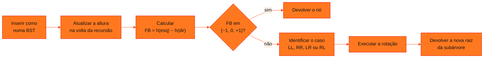

<!-- Documentação acadêmica da aula. Padrão visual: Knowledge Atelier (github.com/RenanMano). -->
<p align="center">
  
</p>
<p align="center">
  
</p>
<p align="center"><a href="#visao-geral">Visão geral</a> &nbsp;·&nbsp; <a href="#fundamentacao-teorica">Teoria</a> &nbsp;·&nbsp; <a href="#exemplos-praticos">Exemplos</a> &nbsp;·&nbsp; <a href="#exercicios-resolvidos">Exercícios</a> &nbsp;·&nbsp; <a href="#aplicacoes">Mercado</a> &nbsp;·&nbsp; <a href="#resumo">Resumo</a> &nbsp;·&nbsp; <a href="#questoes">Questões</a> &nbsp;·&nbsp; <a href="#referencias">Referências</a></p>
<p align="center">
  
  
  
  
  
  
</p>
<p align="center">
  
</p>
<br />

<h2 id="identificacao">Identificação da aula</h2>

| Item | Descrição |
| :--- | :--- |
| Disciplina | [Data Structures and Algorithms](../README.md) |
| Aula | 18 — 15/10/2026 |
| Título | Árvores Balanceadas: Evoluindo uma BST para uma Árvore AVL |
| Tema central | Árvores binárias de busca degeneradas e o custo O(h) da busca; altura armazenada em cada nó, fator de balanceamento, rotações simples e duplas, os quatro casos de desbalanceamento (LL, RR, LR, RL), inserção recursiva autobalanceada em Python, testes obrigatórios e comparação entre BST e AVL com 100 valores crescentes. |
| Tecnologias e ferramentas | Python 3 |
| Docente (conforme material) | Prof. Álvaro Gonçalves |
| Natureza do conteúdo | Aula expositiva com tutorial de implementação (estudo dirigido) |

### Materiais da pasta

| Arquivo | Conteúdo |
| :--- | :--- |
| [`DSA_E12_Arvores_Balanceadas.pdf`](DSA_E12_Arvores_Balanceadas.pdf) | Slides “A Máquina AVL” (18 páginas): BST degenerada × balanceada, fator de balanceamento, ponto de ruptura, rotações que preservam a ordem, os quatro casos (LL, RR, LR, RL), anatomia do nó AVL, fluxo de inserção, missão e testes de calibração, teste de estresse e estruturas de busca × semânticas. |
| [`Tutorial_Balanceamento_AVL.pdf`](Tutorial_Balanceamento_AVL.pdf) | Tutorial de implementação “Evoluindo uma BST para uma Árvore AVL” (8 páginas): revisão obrigatória da BST e 13 etapas, da altura nos nós à comparação entre BST e AVL, com código Python, testes obrigatórios e questões de reflexão. |

> [!NOTE]
> **Limitações da documentação.** A pasta chegou com o nome aula18-15-01-26; como os PDFs foram criados em 13/10/2026 e a aula anterior é de 01/10/2026, ela foi renomeada para aula18-15-10-26. Os slides (18 páginas) são quase só imagens e foram lidos visualmente; eles têm aviso de direitos autorais, por isso o conteúdo é explicado com redação própria. O tutorial foi lido integralmente; a pasta tinha uma segunda cópia idêntica (mesmo hash MD5), Tutorial_Implementacao_Balanceamento_AVL_DSA_Atualizado.pdf, removida a pedido do responsável pelo repositório. Três informações dos slides estavam incorretas ou inconsistentes com o tutorial e aparecem corrigidas nesta página: as sequências dos casos LR e RL, a convenção de altura do slide da BST degenerada e o nó em que ocorre a rotação no exemplo do ponto de ruptura. O tutorial parte de uma implementação de BST feita numa atividade anterior, que não está no repositório. O código do tutorial foi reunido num único programa e executado em Python 3; todas as afirmações numéricas do tutorial conferiram.

<br />

<h2 id="visao-geral">Visão geral</h2>

A [aula 17](../aula17-01-10-26/README.md) apresentou a árvore binária. Uma **árvore binária de busca (BST)** guarda os menores à esquerda e os maiores à direita, e a busca custa **O(h)**, em que *h* é a altura da árvore. O problema é que a ordenação **não garante uma árvore baixa**: inserindo 10, 20, 30, 40 e 50 nessa ordem, a BST vira uma "fila" inclinada, e a busca volta a ser O(n).

A **árvore AVL** resolve isso. Ela é uma BST que, a cada inserção, mede o desequilíbrio de cada nó e o corrige com **rotações**, mantendo a altura em O(log n). A aula combina os slides "A Máquina AVL" com um tutorial que evolui, passo a passo, a BST já implementada pela turma.



*Figura 1 — O fluxo de inserção AVL, conforme o slide "O Fluxo de Inserção AVL" e as etapas do tutorial.*

<br />

<h2 id="objetivos">Objetivos de aprendizagem</h2>

- Explicar por que uma BST pode degenerar e quanto isso custa na busca.
- Armazenar a altura em cada nó e calcular o fator de balanceamento.
- Implementar as rotações à direita e à esquerda e entender por que preservam a ordem.
- Identificar os quatro casos de desbalanceamento e a correção de cada um.
- Adaptar a inserção da BST para uma versão recursiva autobalanceada.
- Validar a árvore com testes e comparar a altura de uma BST e de uma AVL.

<br />

<h2 id="pre-requisitos">Pré-requisitos</h2>

- Árvore binária, nós e percursos, da [aula 17](../aula17-01-10-26/README.md).
- Recursão e caso-base, das [aulas 13](../aula13-08-09-26/README.md) e [14](../aula14-14-09-26/README.md).
- Busca binária e O(log n), da [aula 12](../aula12-03-09-26/README.md).
- Uma implementação de BST com inserção, busca e percurso em ordem (atividade anterior citada no tutorial).

<br />

<h2 id="fundamentacao-teorica">Fundamentação teórica</h2>

### 1. BST degenerada × balanceada

Os slides comparam duas BSTs com os mesmos cinco valores. A **degenerada** (10 → 20 → 30 → 40 → 50) tem **altura 5** e busca O(n). A **balanceada** (raiz 30, filhos 20 e 40, folhas 10 e 50) tem **altura 3** e busca O(log n). A mensagem é direta: **a propriedade de ordenação não garante uma árvore baixa**.

As alturas seguem a convenção usada no restante do material: subárvore vazia tem altura 0 e folha tem altura 1, ou seja, a altura conta **nós**.

> [!NOTE]
> **Correção em relação aos slides.** O slide "BST Degenerada" indica alturas 4 e 2 porque conta **arestas**, convenção diferente da regra AVL apresentada logo depois ("folhas têm altura 1") e do tutorial. Na convenção correta para esta aula, as alturas são 5 e 3.

### 2. Altura e fator de balanceamento

Cada nó passa a guardar sua altura (`self.altura = 1` ao ser criado). A altura de um nó é $1 + \max(h_{esq}, h_{dir})$, e o **fator de balanceamento** é:

$$FB(n) = \text{altura}(\text{esquerda}) - \text{altura}(\text{direita})$$

| FB | Interpretação |
| :---: | :--- |
| −1 | direita um nível mais alta |
| 0 | alturas iguais |
| +1 | esquerda um nível mais alta |
| +2 | desbalanceamento à esquerda |
| −2 | desbalanceamento à direita |

Numa AVL válida, **todo** nó tem FB igual a −1, 0 ou +1.

**O ponto de ruptura.** Na árvore 30 (20 (10), 40), todos os nós estão dentro da regra: o 30 tem FB +1. Ao inserir o 5 abaixo do 10, **dois** nós saem da regra: o 20 (FB +2) e o 30 (FB +2). A correção acontece no **primeiro nó desbalanceado encontrado na volta da recursão**, o 20, com uma rotação à direita (caso LL). O 10 sobe e a árvore fica 30 (10 (5, 20), 40), com o 30 de volta a FB +1. Uma única rotação, no nó mais baixo, já rebalanceia toda a árvore. (O slide "O Ponto de Ruptura" destaca o 30, a raiz que perde a condição AVL; a rotação, porém, é feita no 20.) O tutorial destaca que `altura(no)` só **consulta** o valor armazenado: não percorre a árvore. Por isso as alturas precisam ser atualizadas na volta da recursão, dos nós mais profundos para cima.

### 3. Rotações: reorganizar referências, não dados

Uma rotação muda **quem aponta para quem** sem trocar os valores dos nós. Como o slide resume, rotações **não são algoritmos de ordenação**: elas recuperam o equilíbrio preservando a ordem da BST.

- **Rotação à direita** em `y`: o filho esquerdo `x` sobe, `y` vira filho direito de `x`, e a subárvore `T2` (antigo filho direito de `x`) passa a ser filho esquerdo de `y`.
- **Rotação à esquerda** é simétrica.

Em ambas, atualiza-se primeiro a altura do nó que **desceu** e depois a do que **subiu**, e o método devolve a **nova raiz** da subárvore.

### 4. Os quatro casos

| Caso | Sequência de teste | Forma | Correção |
| :---: | :--- | :--- | :--- |
| LL | 30, 20, 10 | linha reta à esquerda | rotação simples à direita |
| RR | 10, 20, 30 | linha reta à direita | rotação simples à esquerda |
| LR | 30, 10, 20 | zigue-zague | rotação à esquerda no filho, depois à direita na raiz |
| RL | 10, 30, 20 | zague-zigue | rotação à direita no filho, depois à esquerda na raiz |

No código, o caso é decidido pelo FB do nó e pela posição do valor inserido em relação ao filho: por exemplo, LL é `fb > 1 and dado < no.esquerda.dado`.

> [!NOTE]
> **Correção em relação aos slides.** Os slides "Caso LR" e "Caso RL" trazem no subtítulo as sequências 30, 20, 10 e 10, 20, 30, que pertencem aos casos LL e RR. As sequências da tabela acima, **30, 10, 20** (LR) e **10, 30, 20** (RL), são as corretas: são as usadas no slide "Os Testes de Calibração" e no tutorial, e foram conferidas na execução do exemplo básico.

### 5. Inserção recursiva autobalanceada

O tutorial pede que a inserção seja **recursiva**, porque é na volta da recursão que cada ancestral atualiza a altura, calcula o FB e, se preciso, é substituído pela nova raiz devolvida pela rotação. Por isso `inserir` faz `self.raiz = self.inserir_recursivo(self.raiz, dado)`: uma rotação pode mudar a raiz da árvore inteira. Busca, mínimo, máximo e percursos continuam valendo sem mudanças, porque as rotações preservam a propriedade da BST. Já a **remoção** precisa de adaptação própria e fica para uma atividade posterior.

### 6. Por que balancear, e quando não

O slide final distingue **estruturas de busca**, em que o balanceamento é uma estratégia para otimizar o acesso e a hierarquia não tem significado real, de **estruturas semânticas**, como diretórios e organogramas, em que a hierarquia representa relações reais e não deve ser alterada só para reduzir a altura. O tutorial termina lembrando que árvores gerais têm vários filhos por nó, e que estruturas como as árvores B controlam a altura por outros mecanismos.

<br />

<h2 id="exemplos-praticos">Exemplos práticos</h2>

### Exemplo básico — a AVL do tutorial, com os testes obrigatórios

As etapas 1 a 11 do tutorial reunidas numa classe, seguidas dos testes da etapa 11:

```python
# AVL montada a partir das etapas do tutorial (altura em nós: folha = 1, vazio = 0)
class No:
    def __init__(self, dado):
        self.dado = dado
        self.esquerda = None
        self.direita = None
        self.altura = 1


class AVL:
    def __init__(self):
        self.raiz = None

    def altura(self, no):
        return 0 if no is None else no.altura

    def atualizar_altura(self, no):
        no.altura = 1 + max(self.altura(no.esquerda), self.altura(no.direita))

    def fator_balanceamento(self, no):
        return 0 if no is None else self.altura(no.esquerda) - self.altura(no.direita)

    def rotacao_direita(self, y):
        x, temp = y.esquerda, y.esquerda.direita
        x.direita, y.esquerda = y, temp
        self.atualizar_altura(y)                    # primeiro o nó que desceu
        self.atualizar_altura(x)
        return x

    def rotacao_esquerda(self, x):
        y, temp = x.direita, x.direita.esquerda
        y.esquerda, x.direita = x, temp
        self.atualizar_altura(x)
        self.atualizar_altura(y)
        return y

    def inserir_recursivo(self, no, dado):
        if no is None:
            return No(dado)
        if dado < no.dado:
            no.esquerda = self.inserir_recursivo(no.esquerda, dado)
        elif dado > no.dado:
            no.direita = self.inserir_recursivo(no.direita, dado)
        else:
            return no                               # duplicatas não entram
        self.atualizar_altura(no)
        fb = self.fator_balanceamento(no)
        if fb > 1 and dado < no.esquerda.dado:      # LL
            return self.rotacao_direita(no)
        if fb < -1 and dado > no.direita.dado:      # RR
            return self.rotacao_esquerda(no)
        if fb > 1 and dado > no.esquerda.dado:      # LR
            no.esquerda = self.rotacao_esquerda(no.esquerda)
            return self.rotacao_direita(no)
        if fb < -1 and dado < no.direita.dado:      # RL
            no.direita = self.rotacao_direita(no.direita)
            return self.rotacao_esquerda(no)
        return no

    def inserir(self, dado):
        self.raiz = self.inserir_recursivo(self.raiz, dado)   # a raiz pode mudar

    def em_ordem(self, no, saida):
        if no:
            self.em_ordem(no.esquerda, saida)
            saida.append(no.dado)
            self.em_ordem(no.direita, saida)
        return saida

    def mostrar(self, no, nivel=0):
        if no is None:
            return
        self.mostrar(no.direita, nivel + 1)
        print("    " * nivel + f"{no.dado} (h={no.altura}, FB={self.fator_balanceamento(no)})")
        self.mostrar(no.esquerda, nivel + 1)


for caso, seq in (("LL", [30, 20, 10]), ("RR", [10, 20, 30]), ("LR", [30, 10, 20]), ("RL", [10, 30, 20])):
    a = AVL()
    for v in seq:
        a.inserir(v)
    print(caso, seq, "-> raiz", a.raiz.dado, "| em ordem:", a.em_ordem(a.raiz, []))

a = AVL()
for v in [10, 20, 30, 40, 50, 25]:
    a.inserir(v)
a.mostrar(a.raiz)
print("raiz:", a.raiz.dado, "| altura:", a.raiz.altura, "| em ordem:", a.em_ordem(a.raiz, []))
```

Saída esperada:

```text
LL [30, 20, 10] -> raiz 20 | em ordem: [10, 20, 30]
RR [10, 20, 30] -> raiz 20 | em ordem: [10, 20, 30]
LR [30, 10, 20] -> raiz 20 | em ordem: [10, 20, 30]
RL [10, 30, 20] -> raiz 20 | em ordem: [10, 20, 30]
        50 (h=1, FB=0)
    40 (h=2, FB=-1)
30 (h=3, FB=0)
        25 (h=1, FB=0)
    20 (h=2, FB=0)
        10 (h=1, FB=0)
raiz: 30 | altura: 3 | em ordem: [10, 20, 25, 30, 40, 50]
```

Os quatro casos terminam com raiz 20 e percurso `[10, 20, 30]`. A sequência 10, 20, 30, 40, 50, 25 produz exatamente a estrutura esperada no tutorial: raiz 30, altura 3 e percurso em ordem `10 20 25 30 40 50`. É o "teste de estresse" dos slides.

### Exemplo aplicado — BST × AVL com 100 valores crescentes (etapa 13)

```python
# Etapa 13 do tutorial: inserir 1..100 numa BST comum e numa AVL e buscar o 100
class No:
    def __init__(self, dado):
        self.dado, self.esquerda, self.direita, self.altura = dado, None, None, 1

def h(no):
    return no.altura if no else 0

def atualizar(no):
    no.altura = 1 + max(h(no.esquerda), h(no.direita))

def inserir_bst(raiz, dado):                      # iterativa: evita 100 chamadas aninhadas
    novo = No(dado)
    if raiz is None:
        return novo
    atual, caminho = raiz, []
    while True:
        caminho.append(atual)
        lado = "esquerda" if dado < atual.dado else "direita"
        if getattr(atual, lado) is None:
            setattr(atual, lado, novo)
            break
        atual = getattr(atual, lado)
    for no in reversed(caminho):
        atualizar(no)
    return raiz

def rot_dir(y):
    x = y.esquerda; y.esquerda, x.direita = x.direita, y; atualizar(y); atualizar(x); return x

def rot_esq(x):
    y = x.direita; x.direita, y.esquerda = y.esquerda, x; atualizar(x); atualizar(y); return y

def inserir_avl(no, dado):
    if no is None:
        return No(dado)
    if dado < no.dado:
        no.esquerda = inserir_avl(no.esquerda, dado)
    elif dado > no.dado:
        no.direita = inserir_avl(no.direita, dado)
    else:
        return no
    atualizar(no)
    fb = h(no.esquerda) - h(no.direita)
    if fb > 1 and dado < no.esquerda.dado: return rot_dir(no)
    if fb < -1 and dado > no.direita.dado: return rot_esq(no)
    if fb > 1:
        no.esquerda = rot_esq(no.esquerda); return rot_dir(no)
    if fb < -1:
        no.direita = rot_dir(no.direita); return rot_esq(no)
    return no

def visitados(no, alvo):
    n = 0
    while no:
        n += 1
        if alvo == no.dado:
            return n
        no = no.esquerda if alvo < no.dado else no.direita
    return n

bst = avl = None
for v in range(1, 101):
    bst = inserir_bst(bst, v)
    avl = inserir_avl(avl, v)
print(f"BST: altura {bst.altura}, nós visitados para achar 100: {visitados(bst, 100)}")
print(f"AVL: altura {avl.altura}, nós visitados para achar 100: {visitados(avl, 100)}, raiz {avl.dado}")
```

Saída esperada:

```text
BST: altura 100, nós visitados para achar 100: 100
AVL: altura 7, nós visitados para achar 100: 7, raiz 64
```

Inserindo 1, 2, …, 100 em ordem, a BST comum vira uma lista: altura 100 e 100 nós visitados para achar o 100. A AVL fica com altura 7 e visita só 7 nós, como o tutorial afirma. A inserção da BST foi escrita de forma iterativa para não depender de 100 chamadas recursivas aninhadas.

<br />

<h2 id="exercicios-resolvidos">Exercícios e resoluções comentadas</h2>

### Questões de reflexão do tutorial (etapa 13)

**"A ordenação mudou? Os dados mudaram? Ou apenas a organização das referências? Por que o custo da busca é O(h) e a AVL garante h = O(log n)?"**

<details>
<summary><strong>Solução proposta para estudo</strong></summary>

Nem a ordenação nem os dados mudam: o percurso em ordem continua crescente e os valores são os mesmos. Muda só **a organização das referências**. A busca desce um nível por comparação, então visita no máximo *h* nós: custo O(h). A AVL mantém |FB| ≤ 1 em todos os nós, e pode-se demonstrar que isso limita a altura a cerca de $1{,}44 \log_2 n$, ou seja, O(log n). Com 100 valores, a altura ficou 7, perto de $\log_2 100 \approx 6{,}6$.

</details>

### Exercícios propostos para estudo

1. Na cadeia 30 → 20 → 10 ligada à esquerda, quais são os FBs de 10, 20 e 30?
2. Insira 10, 20, 30, 40 e 50, nessa ordem, numa AVL vazia. Quantas rotações acontecem e qual é a árvore final?
3. Por que a rotação à direita precisa atualizar a altura de `y` antes da de `x`?

<details>
<summary><strong>Solução proposta para estudo</strong></summary>

1. 0, +1 e +2, como indica o tutorial.
2. **Duas** rotações à esquerda (caso RR). Ao inserir o 30, o 10 fica com FB −2 e a rotação faz o 20 subir: 20 (10, 30). O 40 entra sem desbalancear. Ao inserir o 50, o 30 fica com FB −2 e a rotação faz o 40 subir. A árvore final é 20 (10, 40 (30, 50)), com altura 3, o que foi conferido com o código do exemplo básico.
3. Porque, depois da rotação, `y` é filho de `x`: a altura de `x` depende da altura já atualizada de `y`.

</details>

<br />

<h2 id="aplicacoes">Aplicações no mercado de trabalho</h2>

- **Bibliotecas e linguagens:** mapas e conjuntos ordenados (como `TreeMap` em Java e `std::map` em C++) usam árvores autobalanceadas, em geral rubro-negras, parentes da AVL.
- **Bancos de dados e sistemas de arquivos:** índices usam árvores B e B+, que controlam a altura com nós de muitos filhos, como o tutorial antecipa.
- **Sistemas em tempo real:** a garantia de O(log n) no **pior caso** é o que importa quando a ordem de chegada dos dados não pode ser controlada.

<br />

<h2 id="boas-praticas">Boas práticas e erros comuns</h2>

| Problemático | Recomendado | Motivo |
| :--- | :--- | :--- |
| `self.inserir_recursivo(self.raiz, dado)` sem atribuir o retorno | `self.raiz = self.inserir_recursivo(self.raiz, dado)` | Uma rotação pode mudar a raiz da árvore |
| Recalcular a altura percorrendo a subárvore | Guardar a altura no nó e atualizá-la na volta da recursão | Mantém a inserção em O(log n) |
| Atualizar a altura de `x` antes da de `y` na rotação | Atualizar primeiro o nó que desceu | A altura do novo pai depende do filho |
| Perder a subárvore `T2` na rotação | Guardar `temp` e religá-lo ao nó que desceu | Sem isso, nós somem da árvore |
| Manter dois métodos `inserir` conflitantes | Adaptar ou substituir a inserção antiga | O tutorial alerta para esse erro |
| Reaproveitar a remoção da BST sem ajustes | Adaptar a remoção com rebalanceamento | Remover também pode desbalancear |

<br />

<h2 id="resumo">Resumo para revisão</h2>

- BST: busca O(h); inserções ordenadas a degeneram em lista (h = n).
- AVL: cada nó guarda a altura; FB = h(esq) − h(dir) deve ficar em {−1, 0, +1}.
- Rotações reorganizam referências e preservam a ordem; devolvem a nova raiz.
- Casos: LL e RR (rotação simples), LR e RL (rotação dupla).
- Inserção recursiva: atualizar altura, checar FB e rotacionar na volta; `self.raiz` recebe o retorno.
- Com 1..100 em ordem: BST de altura 100 × AVL de altura 7.

<br />

<h2 id="questoes">Questões de fixação</h2>

1. Qual é a altura de uma folha e de uma subárvore vazia na convenção do tutorial?
2. Qual correção resolve o caso LR?
3. Por que busca, mínimo e máximo da BST continuam funcionando na AVL sem mudanças?
4. O que acontece se, depois de uma rotação, o retorno não for atribuído ao pai?

<details>
<summary><strong>Respostas comentadas</strong></summary>

1. Folha: 1. Subárvore vazia: 0.
2. Rotação à esquerda no filho esquerdo e, depois, rotação à direita no nó desbalanceado.
3. Porque as rotações preservam a propriedade da BST: tudo à esquerda continua menor e tudo à direita continua maior.
4. O pai continua apontando para o nó antigo, que agora é filho da nova raiz: parte da árvore fica inacessível ou a estrutura fica inconsistente.

</details>

<br />

<h2 id="referencias">Referências e materiais complementares</h2>

- ADELSON-VELSKY, G. M.; LANDIS, E. M. *An algorithm for the organization of information* (1962), artigo original que deu nome à árvore AVL.
- Árvore binária e percursos: [aula 17](../aula17-01-10-26/README.md)
- Materiais da pasta: [slides “Árvores Balanceadas”](DSA_E12_Arvores_Balanceadas.pdf) · [tutorial de implementação AVL](Tutorial_Balanceamento_AVL.pdf)

<br />

<p align="center"><a href="../aula17-01-10-26/README.md">← Aula anterior</a> &nbsp;·&nbsp; <a href="../README.md">Índice da disciplina</a></p>

<p align="center"></p>
